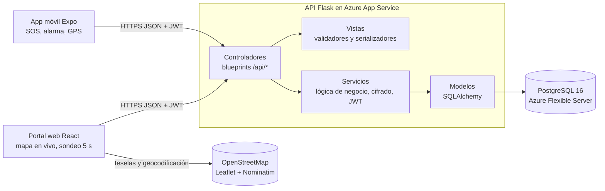

# Ruta Segura: documento de arquitectura

> Grupo SmartCode, ciclo Profundización. Maratón de programación con impacto social, 4 de noviembre de 2026.
> URL pública: https://smartcode-maraton-app-c7f9asg3badvf8fr.spaincentral-01.azurewebsites.net

## 1. Problema y ODS
Muchas mujeres se sienten inseguras en el espacio público de noche (paraderos, calles sin luz, trayectos a pie). En una situación de riesgo no hay tiempo de desbloquear el celular, abrir una app y escribir un mensaje. **Ruta Segura** permite activar una alerta con un gesto rápido (tres toques en la pantalla). El teléfono hace sonar una alarma a todo volumen y empieza a enviar la ubicación cada 5 segundos. Sus familiares (rol *guardian*) la ven en vivo en un portal web. Si el teléfono deja de enviar datos, el portal muestra la **última ubicación conocida con su hora** y la marca **"Señal perdida"**.

- **ODS 5 (Igualdad de género):** reduce un riesgo que afecta de forma desproporcionada a las mujeres.
- **ODS 11 (Ciudades sostenibles):** contribuye a un espacio público nocturno más seguro.
- **ODS 16 (Paz, justicia e instituciones sólidas):** facilita una respuesta rápida ante la violencia.

## 2. Arquitectura en capas (MVC)

| Capa | Carpeta | Responsabilidad |
|---|---|---|
| Modelos | `api/app/models/` | Tablas `users`, `guardian_links`, `alerts` y `location_points`. |
| Vistas | `api/app/views/` | Validación de entradas (`validators.py`) y forma de las respuestas JSON (`serializers.py`). |
| Controladores | `api/app/controllers/` | Blueprints HTTP: `auth`, `links`, `alerts` y `health`. No consultan la base directamente. |
| Servicios | `api/app/services/` | Reglas de negocio, autorización por dueño y por vínculo, cifrado Fernet, JWT y bcrypt. |
| Presentación | `web/`, `mobile/` | Portal React (familiares) y app Expo (mujer usuaria). |

## 3. Decisiones técnicas
| Decisión | Por qué |
|---|---|
| Flask + SQLAlchemy | Es liviano para el plan F1 gratuito (1 GB de RAM), el equipo lo conoce y separa bien las capas MVC. |
| Monorepo con una sola App Service | La API sirve el build de React en `/`. Hay un solo despliegue y un mismo origen, así que no hace falta CORS en producción. |
| Sondeo (*polling*) cada 5 s en lugar de WebSockets | El plan F1 limita la CPU a 60 min al día y gunicorn usa 1 worker. Cada consulta es corta y usa índices. |
| Alerta idempotente | Si la usuaria pulsa varias veces el SOS, se reutiliza la alerta activa en lugar de crear duplicados. |
| JWT de 60 minutos | Es corto, pero no corta el envío de ubicación durante una alerta activa. Los *refresh tokens* quedan como trabajo futuro. |
| SQLite en local, PostgreSQL en Azure | El firewall de Azure solo admite servicios de Azure. La URL de la base se lee de `DATABASE_URL`. |

## 4. Modelo de datos
- **users**(id, email único, password_hash bcrypt, full_name, role `user`/`guardian`, phone_encrypted, invite_code único, created_at)
- **guardian_links**(id, guardian_id → users, user_id → users, created_at; único por pareja)
- **alerts**(id, user_id → users, status `active`/`closed`, started_at, closed_at)
- **location_points**(id, alert_id → alerts, coords_encrypted, recorded_at; índice (alert_id, recorded_at))

## 5. API externa
_(Pendiente: OpenStreetMap con Leaflet para el mapa y Nominatim para mostrar la dirección aproximada. Se cambia a Google Maps JavaScript API si existe `VITE_GOOGLE_MAPS_API_KEY`.)_

## 6. Seguridad (OWASP Top 10)
| Riesgo | Protección | Prueba |
|---|---|---|
| A01 Control de acceso roto | Autorización por rol, por dueño de la alerta y por vínculo familiar en cada endpoint. | `test_unlinked_guardian_cannot_see_location`, `test_user_cannot_touch_another_users_alert`, `test_guardian_cannot_start_alert` |
| A02 Fallas criptográficas | bcrypt para contraseñas. Teléfono y coordenadas cifrados con Fernet (llave derivada de `SECRET_KEY` con SHA-256). HTTPS y HSTS. | `test_password_is_stored_as_bcrypt_hash`, `test_phone_is_encrypted_at_rest`, `test_coordinates_encrypted_at_rest` |
| A03 Inyección | Solo consultas parametrizadas con SQLAlchemy. Validación estricta de tipos y rangos. | `test_sql_injection_in_login_is_harmless`, `test_location_validation`, `test_register_validates_input` |
| A04 Diseño inseguro | Mensajes de login genéricos, bcrypt también cuando la cuenta no existe (evita enumerar cuentas), límite de 16 KB por solicitud y límite de intentos al vincular con código de invitación (5 por minuto, 30 por día) contra la adivinación de códigos. | `test_login_error_is_generic`, `test_oversized_body_rejected`, `test_invite_code_guessing_is_rate_limited` |
| A05 Configuración insegura | Cabeceras CSP, X-Frame-Options, nosniff, HSTS y Referrer-Policy. CORS restringido. Sin `debug`. | `test_security_headers_present`, `test_cors_rejects_unknown_origin` |
| A07 Fallas de autenticación | JWT HS256 con expiración y algoritmo fijo, y límite de 5 intentos de login por minuto. | `test_login_is_rate_limited`, `test_expired_token_rejected`, `test_tampered_token_rejected`, `test_token_with_none_algorithm_rejected` |
| A09 Registro y monitoreo | Errores inesperados registrados en stdout (Azure Log Stream) sin exponer detalles a la persona usuaria. | `test_unexpected_errors_hide_details` |
| A06, A08, A10 | Dependencias con versión fija, CI que corre las pruebas antes de desplegar, y el servidor no hace peticiones a URLs que mande el usuario (no hay SSRF). | CI en GitHub Actions |

## 7. Despliegue y CI/CD en Azure
_(Pendiente de completar al cierre: flujo de GitHub Actions → Azure App Service, comando gunicorn, variables de entorno.)_

## 8. Escalabilidad y sostenibilidad
_(Pendiente: API sin estado, base de datos como única fuente de verdad, ruta de escalado horizontal, operación de bajo costo.)_

## 9. Limitaciones y trabajo futuro
_(Pendiente.)_
