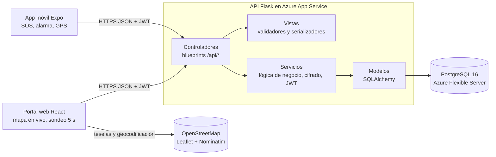
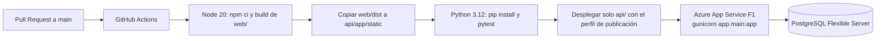

# Ruta Segura: documento de arquitectura

> Grupo SmartCode, ciclo Profundización. Maratón de programación con impacto social, 4 de noviembre de 2026.
> URL pública: https://smartcode-maraton-app-c7f9asg3badvf8fr.spaincentral-01.azurewebsites.net

## 1. Problema y ODS
Muchas mujeres se sienten inseguras en el espacio público de noche (paraderos, calles sin luz, trayectos a pie). En una situación de riesgo no hay tiempo de desbloquear el celular, abrir una app y escribir un mensaje. **Ruta Segura** permite activar una alerta con un gesto rápido (tres toques en la pantalla). El teléfono hace sonar una alarma a todo volumen y empieza a enviar la ubicación cada 5 segundos. Sus familiares (rol *guardian*) la ven en vivo en un portal web. Si el teléfono deja de enviar datos, el portal muestra la **última ubicación conocida con su hora** y la marca **"Señal perdida"**.

- **ODS 5 (Igualdad de género):** reduce un riesgo que afecta de forma desproporcionada a las mujeres.
- **ODS 11 (Ciudades sostenibles):** contribuye a un espacio público nocturno más seguro.
- **ODS 16 (Paz, justicia e instituciones sólidas):** facilita una respuesta rápida ante la violencia.

## 2. Arquitectura en capas (MVC)

| Capa | Carpeta | Responsabilidad |
|---|---|---|
| Modelos | `api/app/models/` | Tablas `users`, `guardian_links`, `alerts` y `location_points`. |
| Vistas | `api/app/views/` | Validación de entradas (`validators.py`) y forma de las respuestas JSON (`serializers.py`). |
| Controladores | `api/app/controllers/` | Blueprints HTTP: `auth`, `links`, `alerts` y `health`. No consultan la base directamente. |
| Servicios | `api/app/services/` | Reglas de negocio, autorización por dueño y por vínculo, cifrado Fernet, JWT y bcrypt. |
| Presentación | `web/`, `mobile/` | Portal React (familiares) y app Expo (mujer usuaria). |

## 3. Decisiones técnicas
| Decisión | Por qué |
|---|---|
| Flask + SQLAlchemy | Es liviano para el plan F1 gratuito (1 GB de RAM), el equipo lo conoce y separa bien las capas MVC. |
| Monorepo con una sola App Service | La API sirve el build de React en `/`. Hay un solo despliegue y un mismo origen, así que no hace falta CORS en producción. |
| Sondeo (*polling*) cada 5 s en lugar de WebSockets | El plan F1 limita la CPU a 60 min al día y gunicorn usa 1 worker. Cada consulta es corta y usa índices. |
| Alerta idempotente | Si la usuaria pulsa varias veces el SOS, se reutiliza la alerta activa en lugar de crear duplicados. |
| JWT de 60 minutos | Es corto, pero no corta el envío de ubicación durante una alerta activa. Los *refresh tokens* quedan como trabajo futuro. |
| SQLite en local, PostgreSQL en Azure | El firewall de Azure solo admite servicios de Azure. La URL de la base se lee de `DATABASE_URL`. |

## 4. Modelo de datos
- **users**(id, email único, password_hash bcrypt, full_name, role `user`/`guardian`, phone_encrypted, invite_code único, created_at)
- **guardian_links**(id, guardian_id → users, user_id → users, created_at; único por pareja)
- **alerts**(id, user_id → users, status `active`/`closed`, started_at, closed_at)
- **location_points**(id, alert_id → alerts, coords_encrypted, recorded_at; índice (alert_id, recorded_at))

## 5. API externa y datos abiertos
- **OpenStreetMap (datos abiertos) con Leaflet:** las teselas del mapa en vivo del portal.
- **Nominatim (geocodificación inversa de OpenStreetMap):** convierte la última coordenada en una dirección legible ("Carrera 5, Cogua…"). Para respetar su política de uso, se consulta como máximo cada 15 s y solo si la persona se movió unos 20 m.
- **Google Maps JavaScript API (opcional):** si al compilar existe el secreto `VITE_GOOGLE_MAPS_API_KEY`, el portal usa Google Maps en lugar de Leaflet. La llave nunca está en el código.
- **APIs del dispositivo (Expo):** GPS (`expo-location`), audio (`expo-audio`), vibración y almacenamiento seguro del token (`expo-secure-store`).

## 5.1 Disparador de la alerta (decisión de diseño)
El **botón físico de encendido no se puede leer desde Expo**. Android no entrega ese evento a las apps sin código nativo propio (un servicio de accesibilidad o un receptor de pantalla encendida/apagada), y nada de eso funciona en Expo Go ni en un proyecto administrado sin un módulo nativo a medida. Por eso **el disparador es tocar 3 veces seguidas (en menos de 1,5 s) el botón SOS**, que ocupa buena parte de la pantalla. Es rápido, no necesita mirar el teléfono y evita activaciones accidentales. En el APK, la app además sube al máximo el volumen del sistema (multimedia y alarma) con `react-native-volume-manager`. En Expo Go el volumen del sistema no se puede cambiar, así que se usa el volumen del reproductor en 1.0 más vibración continua.

## 6. Seguridad (OWASP Top 10)
| Riesgo | Protección | Prueba |
|---|---|---|
| A01 Control de acceso roto | Autorización por rol, por dueño de la alerta y por vínculo familiar en cada endpoint. | `test_unlinked_guardian_cannot_see_location`, `test_user_cannot_touch_another_users_alert`, `test_guardian_cannot_start_alert` |
| A02 Fallas criptográficas | bcrypt para contraseñas. Teléfono y coordenadas cifrados con Fernet (llave derivada de `SECRET_KEY` con SHA-256). HTTPS y HSTS. | `test_password_is_stored_as_bcrypt_hash`, `test_phone_is_encrypted_at_rest`, `test_coordinates_encrypted_at_rest` |
| A03 Inyección | Solo consultas parametrizadas con SQLAlchemy. Validación estricta de tipos y rangos. | `test_sql_injection_in_login_is_harmless`, `test_location_validation`, `test_register_validates_input` |
| A04 Diseño inseguro | Mensajes de login genéricos, bcrypt también cuando la cuenta no existe (evita enumerar cuentas), límite de 16 KB por solicitud y límite de intentos al vincular con código de invitación (5 por minuto, 30 por día) contra la adivinación de códigos. | `test_login_error_is_generic`, `test_oversized_body_rejected`, `test_invite_code_guessing_is_rate_limited` |
| A05 Configuración insegura | Cabeceras CSP, X-Frame-Options, nosniff, HSTS y Referrer-Policy. CORS restringido. Sin `debug`. | `test_security_headers_present`, `test_cors_rejects_unknown_origin` |
| A07 Fallas de autenticación | JWT HS256 con expiración y algoritmo fijo, y límite de 5 intentos de login por minuto. | `test_login_is_rate_limited`, `test_expired_token_rejected`, `test_tampered_token_rejected`, `test_token_with_none_algorithm_rejected` |
| A09 Registro y monitoreo | Errores inesperados registrados en stdout (Azure Log Stream) sin exponer detalles a la persona usuaria. | `test_unexpected_errors_hide_details` |
| A06, A08, A10 | Dependencias con versión fija, CI que corre las pruebas antes de desplegar, y el servidor no hace peticiones a URLs que mande el usuario (no hay SSRF). | CI en GitHub Actions |

## 7. Despliegue y CI/CD en Azure

- **Infraestructura** (preparada antes del evento): grupo `rg-maraton`, región Spain Central, App Service Linux F1 y PostgreSQL 16 Flexible Server con firewall que solo admite servicios de Azure.
- **Arranque:** `gunicorn --bind=0.0.0.0:8000 --workers 1 --threads 4 app.main:app`.
- **Variables de entorno** (solo en Azure, nunca en el repositorio): `DATABASE_URL` con SSL, `SECRET_KEY` (firma JWT y deriva la llave Fernet) y `SCM_DO_BUILD_DURING_DEPLOYMENT=1`.
- **Tablas:** se crean al arrancar con `db.create_all()`.
- **Salud:** `GET /api/health` responde `{"status":"ok"}` sin tocar la base.
- **Si fallan las pruebas, no se despliega.** Cada merge a `main` publica en 2 a 3 minutos.
- **App móvil:** APK con EAS Build (perfil `preview` en `mobile/eas.json`), que apunta a la URL pública de Azure.

## 8. Escalabilidad y sostenibilidad
- **API sin estado:** la sesión vive en el JWT y no en memoria del servidor, así que cualquier instancia puede atender cualquier petición.
- **La base de datos es la única fuente de verdad:** alertas y ubicaciones viven en PostgreSQL. Nada se guarda en el disco efímero de la App Service.
- **Ruta de escalado horizontal:**
  1. Subir el plan a B1 o S1 y aumentar instancias o workers de gunicorn.
  2. Llevar el límite de intentos (hoy en memoria, válido con 1 worker) a Redis.
  3. Agregar réplicas de lectura de PostgreSQL para el sondeo de los familiares.
  4. Si la carga lo exige, cambiar el sondeo por Azure Web PubSub o SignalR.
- **Consultas livianas:** el sondeo de 5 s usa índices (`alert_id`, `recorded_at`) y devuelve máximo los últimos 30 puntos.
- **Operación de bajo costo:** el plan F1 es gratuito, la base es de nivel básico y los mapas son abiertos (OpenStreetMap), así que no hay costo por llamada. Esto la hace viable para alcaldías, universidades u organizaciones sociales con poco presupuesto.
- **Sostenibilidad social:** el código es de una sola base y está documentado. Otra ciudad la puede desplegar cambiando solo las variables de entorno.

## 9. Limitaciones y trabajo futuro
| Limitación | Trabajo futuro |
|---|---|
| El botón físico de encendido no se puede usar como disparador desde Expo (ver 5.1). | Módulo nativo con servicio de accesibilidad o atajo del sistema. |
| La ubicación se envía solo con la app en primer plano (no se pide ubicación en segundo plano). | Servicio en primer plano de Android con notificación persistente. |
| El volumen del sistema solo se fuerza en el APK; en Expo Go se usa el del reproductor y la vibración. | — |
| El vínculo con un familiar se crea solo con el código, sin que la usuaria lo apruebe, y no se puede revocar desde la app. | Aprobación explícita de cada vínculo, lista de familiares y opción de revocar. |
| El JWT dura 60 min y no hay *refresh token*. | *Refresh tokens* rotativos y cierre de sesión en el servidor. |
| El límite de intentos se guarda en memoria del proceso. | Redis cuando haya varias instancias. |
| Nominatim es un tercero y recibe la última coordenada. | Geocodificar en el servidor o usar una instancia propia. |
| Sondeo cada 5 s, con hasta 5 s de retraso. | Notificaciones push (Expo Notifications) y WebSockets gestionados. |
| No hay botón de llamar a la Línea 123 desde la app. | Llamada o SMS automático a un contacto de emergencia. |
